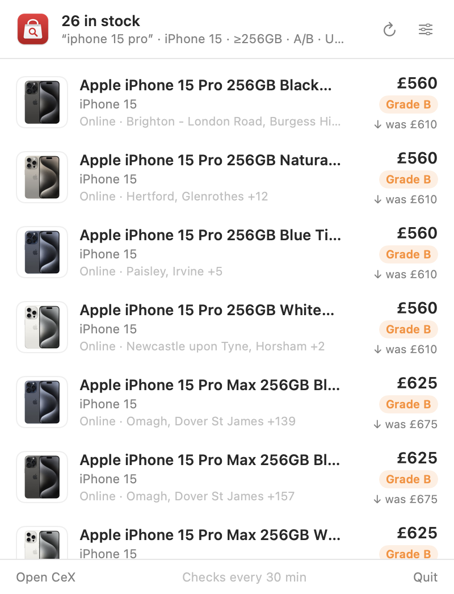
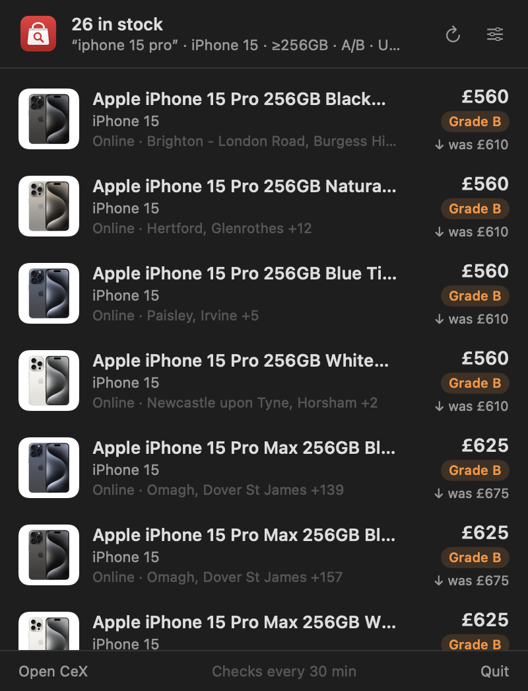
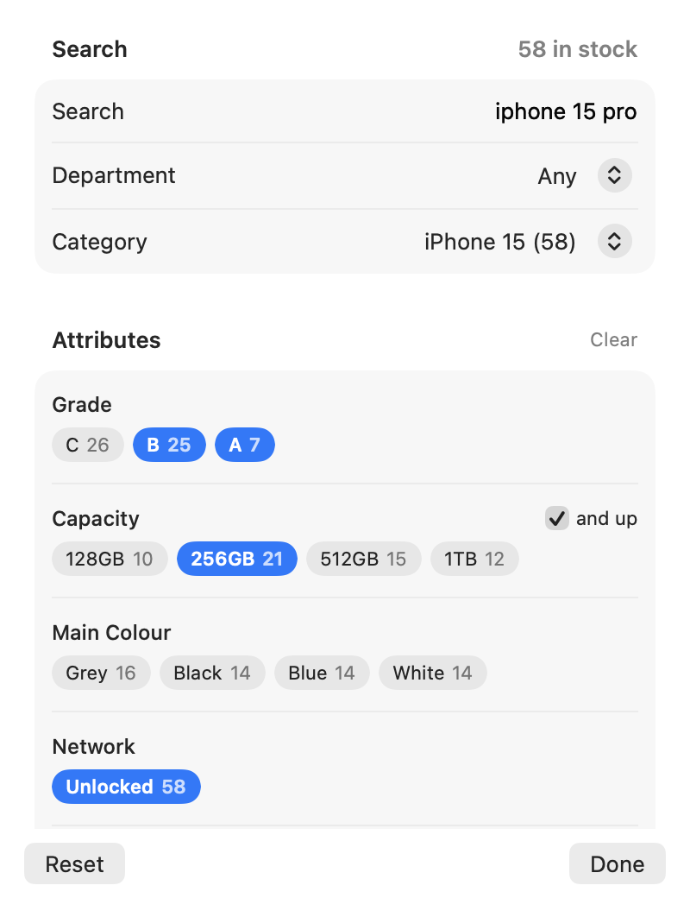

<!-- LOGO -->
<h1>
<p align="center">
  
  <br>CeX Bar
</h1>
  <p align="center">
    A menu bar app that watches CeX UK stock for anything you're after.
    <br />
    Search anything, filter on what CeX knows about it, and get a notification when it turns up.
    <br />
    <a href="#about">About</a>
    ·
    <a href="https://github.com/joshjkns/cexbar/releases">Download</a>
    ·
    <a href="#features">Features</a>
    ·
    <a href="#developing">Developing</a>
    ·
    <a href="#how-it-works">How it works</a>
  </p>
</p>

<p align="center">
  
  
</p>

## About

CeX Bar sits in your menu bar and keeps an eye on [CeX UK](https://uk.webuy.com)
for you. Tell it what you want, whether that's a 14″ M4 Pro MacBook with at least
36 GB of RAM, an unlocked iPhone in grade A or B, or a Zelda game under £20, and
it checks on a schedule and notifies you the moment a new listing appears.

It started as a script to catch a specific MacBook before it sold out, and grew
into something that works for anything CeX sells:

- **Any search.** Games, phones, laptops, films, music, cameras: if CeX lists
  it, you can watch it.
- **Real filters.** Department, category and attributes come from CeX's own
  data for your results, so a phone search offers Capacity and Network and a
  laptop search offers RAM and Screen Size.
- **Tiny.** One Swift file, one ~2 MB universal app. No Electron, no account,
  nothing to sign in to.

## Features

### Watching

- Checks every 15 minutes, 30 minutes, 1 hour or 3 hours, or only when you ask
- **Notifications** for new listings. Click one to open it on CeX
- The menu bar icon fills in and shows a count when something new appears,
  and new rows get a **NEW** tag
- Prices show the change since the last price (`↓ was £610`)
- Stock shows online availability and which stores have it
- Optional **open at login**

### Filtering

<p align="center">
  
</p>

- **Department and category** pickers, filled from your search with in-stock
  counts
- **Attribute chips** for whatever CeX records about the results, such as Grade,
  Capacity, RAM, Screen Size, Network, Colour, Platform or CPU. Chips in one
  attribute are OR'd, and different attributes are AND'd
- **And up** for sizes: pick `36GB` and tick *and up* to match 36, 48, 64 GB
  and anything bigger that turns up later
- Messy spellings are merged, so `48GB` and `48GB RAM` count as the same thing
- **Keywords:** *must contain any of* and *exclude*, matched against the
  listing name (`M4 Pro, M4 Max`, `NTD, Boxed`)
- Price range, specific stores (`Bristol, Kingswood`) and online only
- Sort by price either way, biggest price drop or name

## Download

Get the latest `CeX-Bar-*.zip` from
[Releases](https://github.com/joshjkns/cexbar/releases), unzip it and drag
**CeX Bar** into Applications. It runs on Apple Silicon and Intel Macs with
macOS 13 or later.

CeX Bar is signed ad-hoc but not notarised by Apple, so macOS blocks it the
first time you open it. To allow it, either:

- open it once, then go to **System Settings → Privacy & Security** and click
  **Open Anyway**, or
- run this in a terminal:

  ```sh
  xattr -dr com.apple.quarantine "/Applications/CeX Bar.app"
  ```

Then click the bag in the menu bar and press **Set up a search**.

## Developing

You need the Xcode command line tools (`xcode-select --install`).

```sh
./build.sh && open "CeX Bar.app"           # build for this Mac and run it
UNIVERSAL=1 VERSION=1.2.0 ./build.sh       # Apple Silicon + Intel, with a version number
```

**Stack:** Swift · SwiftUI `MenuBarExtra` · UserNotifications. No dependencies.

```
CeXBar.swift   the whole app: CeX search, filters, store, notifications and UI
build.sh       compiles the app bundle, Info.plist and icon with swiftc
AppIcon.icns   app icon, generated from docs/logo.svg
```

### Releasing

Push a version tag and GitHub Actions builds a universal app and attaches it
to a release:

```sh
git tag v1.2.0 && git push origin v1.2.0
```

You can also run the **Release** workflow by hand from the Actions tab.

## How it works

- CeX's own search page is powered by Algolia (`search.webuy.io`). CeX Bar
  queries the same index with the public, search-only key the site gives
  every browser. It's unofficial, so it may break if CeX changes their site.
  Keep auto-refresh modest.
- Only in-stock listings (online or in a store) are fetched. Department,
  category and price filters run on the server; attribute and keyword filters
  run locally, because many listings are missing attributes or spell them
  differently.
- Filter options come from three facet queries per search: departments for
  the search, categories within the chosen department, and attributes within
  the chosen category. Each level leaves out its own selection so you can
  still see the alternatives.
- Algolia returns at most 1,000 results per search. If yours has more, the
  window says so and asks you to narrow it.
- "New" means a listing that wasn't in the previous check. Changing filters
  resets this, so you aren't notified about everything at once.
- Settings live in `UserDefaults` (`local.josh.cexbar`). Nothing leaves your
  Mac except the search requests to CeX.

---

<p align="center"><sub>Not affiliated with CeX.</sub></p>
